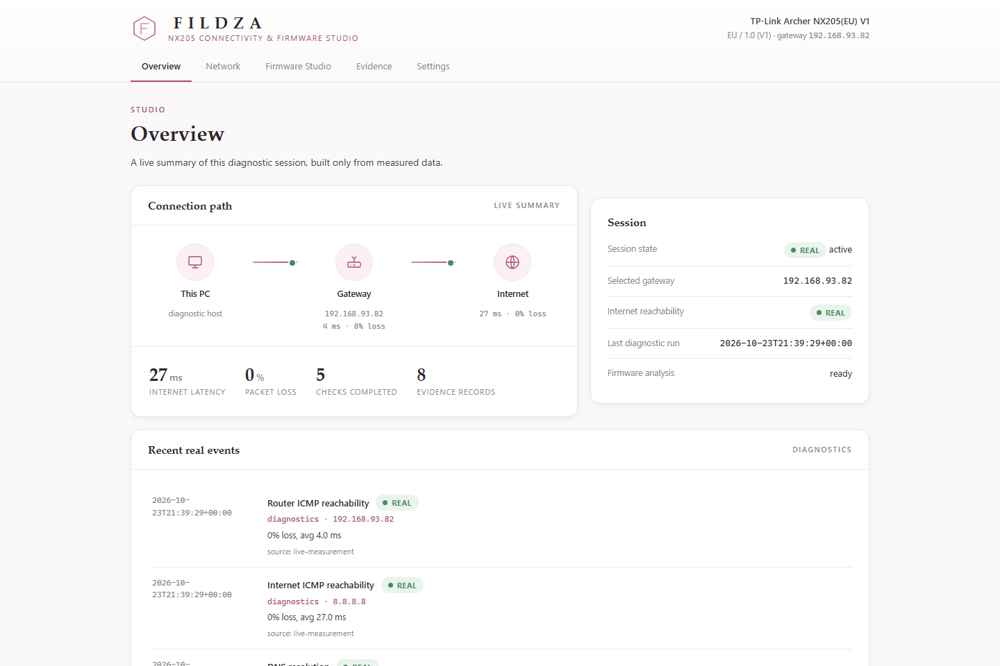
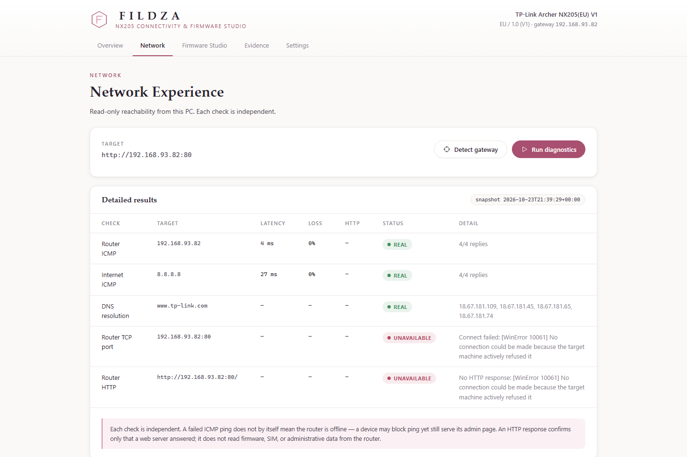
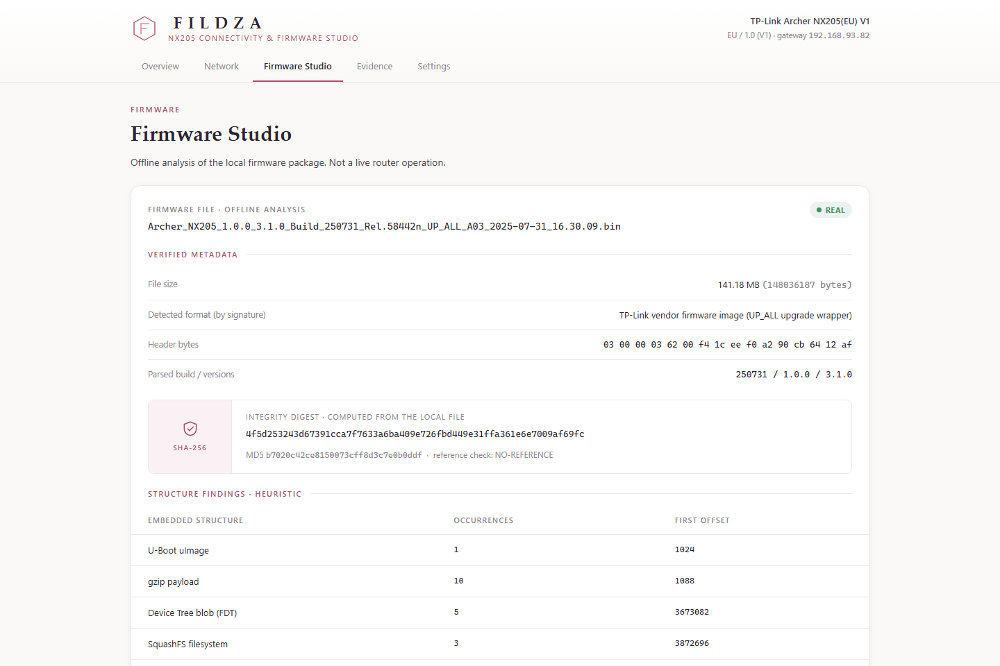
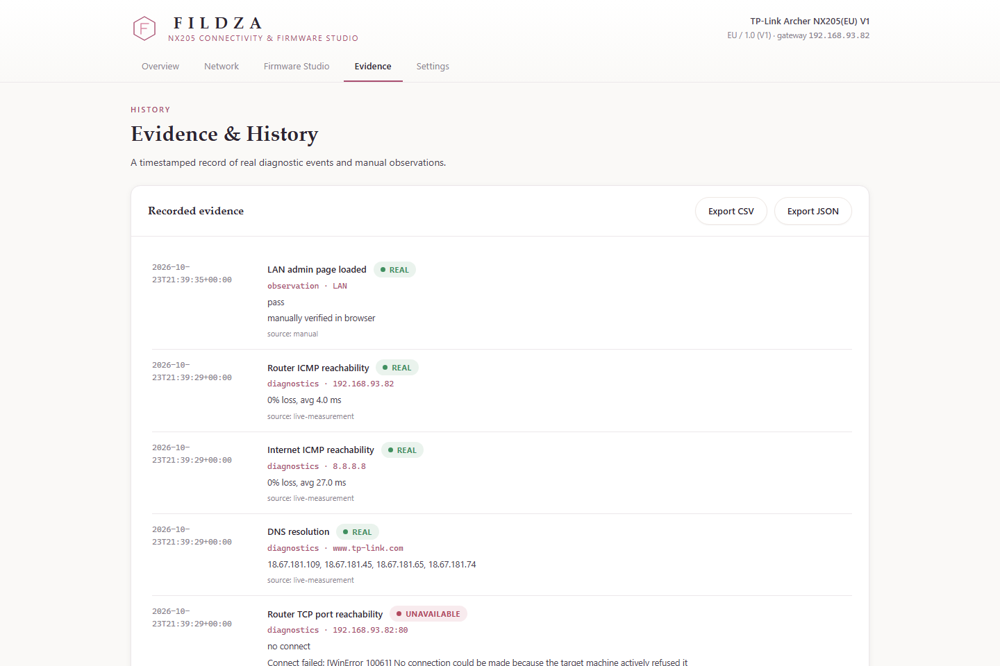
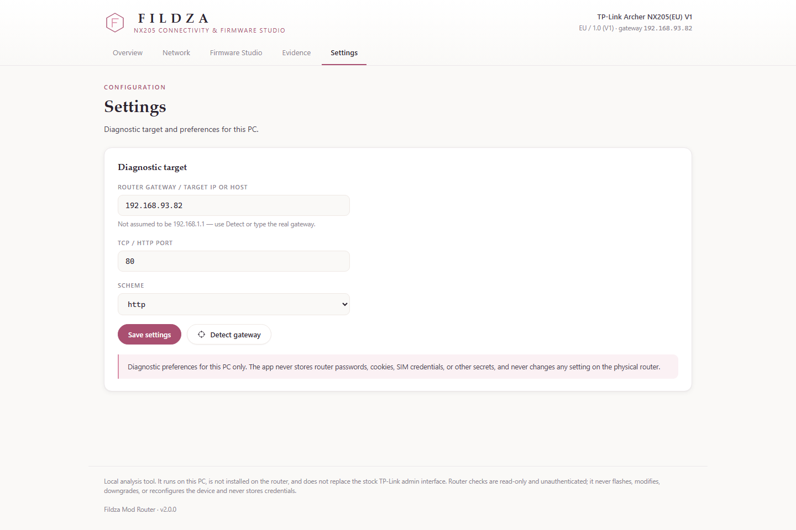

<div align="center">

# FILDZA MOD ROUTER
### NX205 Connectivity & Firmware Studio

A personal engineering project: a local workstation for **firmware-file
analysis** and **read-only network diagnostics**, built around my own
**TP-Link Archer NX205(EU) V1**.

*Personal project by **Fildza**. Not affiliated with, endorsed by, or
redistributing anything from TP-Link. Built for my own learning and portfolio —
not a university assignment, not a product, not for distribution to end users.*

</div>

---

## What this actually is

I wanted to understand my own router better — what's really inside the
firmware image TP-Link ships, and how to build proper read-only network
diagnostic tooling instead of clicking around a web UI. This project is the
result: a small local web app (own design, "Porcelain & Rose" visual identity)
sitting on top of a Python engine that does real work — SHA-256/format
analysis of the firmware file, and live ICMP/DNS/TCP/HTTP reachability checks
against the router.

It runs **entirely on my own PC**. It is **not** installed on the router and
**does not** replace the stock TP-Link admin interface. Every router check is
**read-only and unauthenticated** — no login, no flashing, no config changes,
no device-identity tampering, no credential storage. See [Boundaries](#boundaries-what-this-deliberately-does-not-do)
below for why, and for what I looked into and ruled out.

---

## Screenshots

<table>
<tr>
<td width="50%">

**Overview** — live connection path (This PC → Gateway → Internet), built only
from numbers the engine actually measured.



</td>
<td width="50%">

**Network** — five independent read-only checks: router ICMP, internet ICMP,
DNS, router TCP port, router HTTP response.



</td>
</tr>
<tr>
<td width="50%">

**Firmware Studio** — SHA-256 integrity panel, signature-detected format,
embedded-structure heuristics, all computed from the local `.bin` file.



</td>
<td width="50%">

**Evidence & History** — timestamped real events + manual observations,
exportable to CSV/JSON.



</td>
</tr>
</table>

<details>
<summary>Settings view</summary>



</details>

> The data shown in these screenshots is real output from my own hotspot
> network during development (gateway `192.168.93.82`), captured to document
> what the UI looks like with live data flowing through it — not fabricated.

---

## Status vocabulary (used everywhere, never blurred)

| Badge | Meaning |
|---|---|
| `REAL` | Measured or computed during this session |
| `UNAVAILABLE` | The check ran, target did not respond |
| `ERROR` | The check could not execute (e.g. no target set) |
| `PLACEHOLDER` | Sample/seed data, not verified against the real device |

No fake latency, packet loss, DNS answers, HTTP codes, SIM/5G status, or
uptime — anywhere. If the engine didn't measure it, the UI says so.

---

## Technology stack (actual)

- **Python 3.8+ standard library only** — `http.server`, `hashlib`, `socket`,
  `subprocess`, `urllib`, `json`, `csv`, `argparse`, `unittest`. No `pip
  install` needed.
- **Web UI** — a single static page (`webui/`) in vanilla HTML/CSS/JS. No
  framework, no CDN, no build step, no React.
- Developed and tested on **Python 3.11, Windows 11**.

## Architecture

```
workstation.py             Launcher — CLI, starts the local server, opens the UI
src/workstation_server.py  http.server backend (127.0.0.1) + JSON API
webui/                     index.html · app.css · app.js — the UI itself
src/network_diagnostics.py ping / DNS / TCP / HTTP probes + gateway detection
firmware_inspector.py      Directory scan + orchestration
src/firmware_analysis.py   Format / metadata / embedded-structure / entropy
src/hashing.py             SHA-256 / MD5
src/file_detection.py      Signature (magic-byte) detection
src/evidence_log.py        Unified evidence events + CSV/JSON export
src/connectivity_tests.py  Manual observation log
src/branding.py            Product identity (single source of truth)
main.py / dashboard.py     Earlier console + static-HTML prototypes (kept)
data/                      Logs & settings (gitignored — your own local data)
tests/                     68 unittest cases
```

---

## Getting the firmware

The `.bin`/PDF package from TP-Link (~142 MB) is **not included in this
repo** — GitHub caps files at 100 MB anyway, and redistributing vendor
firmware publicly isn't something I'm going to do. If you want to point this
tool at your own copy:

1. Download your firmware package from TP-Link's official support page for
   your exact model/region/hardware version.
2. Extract it next to this project as
   `Archer_NX205(EU)_<version>_<build>/` (or point `firmware_inspector.py` /
   `workstation.py` at wherever you put it).
3. The `.gitignore` already keeps that folder out of version control.

## Setup & launch (Windows)

```powershell
git clone https://github.com/fxfanxy/nx205-firmware-analysis.git
cd nx205-firmware-analysis
python workstation.py
```

No dependencies to install. This auto-detects your default gateway, starts
the local UI at `http://127.0.0.1:8787/` (or the next free port), and opens
your browser.

```powershell
python workstation.py --router 192.168.1.1 --port 443 --scheme https
python workstation.py --serve-port 8080 --no-open
python workstation.py --no-detect        # skip gateway auto-detection
```

### Workflow
1. Launch → confirm the detected gateway in the top bar (or set it in Settings).
2. **Network → Run diagnostics** → inspect the five results.
3. **Firmware Studio** → review SHA-256 and file metadata.
4. **Evidence** → review the timeline, **Export CSV/JSON**.

### Earlier prototypes (still functional, kept for reference)
```powershell
python dashboard.py --open   # one-shot static HTML dashboard
python main.py                # console inspector
```

---

## Tests

```powershell
python -m unittest discover -s tests -v
```

**68 tests, all passing** on Python 3.11 / Windows 11 — covering hashing,
signature detection, firmware metadata parsing, the ping/DNS/TCP/HTTP
diagnostic parsers, gateway detection (including busy-port handling), the
evidence log, and the local HTTP API end-to-end.

These tests validate the **software only**. They are not, and do not claim to
be, validation against the physical router — that only happens when I
actually run `workstation.py` on my own LAN.

---

## Boundaries (what this deliberately does not do)

This started as curiosity about whether a legitimate custom firmware build or
admin-UI replacement was even possible for this exact hardware. Short answer:
**no**, and I looked into why before deciding not to pursue it —

- No NX205 entry exists in OpenWrt's hardware list; no community port.
- TP-Link's GPL releases cover GPL *components* (kernel, BusyBox, …), not a
  complete buildable image, packaging tool, or signing key.
- The `.bin` is vendor-signed (proprietary header); the bootloader verifies
  that signature, and TP-Link's private key isn't public — a self-built image
  gets rejected, or worse, bricks the device.
- Newer official firmware explicitly disables downgrading (anti-rollback).

So this project stays firmly on the legitimate side of that line:

- **No firmware flashing**, no signature-verification or anti-rollback bypass.
- **No router configuration changes**, no IMEI/device-identity or SIM
  manipulation, no carrier hotspot-restriction bypass.
- **No authentication bypass**, no credential collection or storage —
  diagnostics are unauthenticated and read-only by construction.
- An HTTP response confirms only that a web server answered — never that
  firmware, SIM, or admin data was read.

---

## Ideas / things I'd add next

Things I think would genuinely improve this, roughly in the order I'd
tackle them:

- **Latency history over time** — append each diagnostic run's numbers to a
  small time series and chart it on the Overview, instead of only showing the
  latest snapshot.
- **Saved gateway profiles** — quick-switch between "home", "hotspot",
  "travel router" targets instead of retyping Settings each time.
- **Scheduled diagnostics** — an opt-in background timer (or a Windows Task
  Scheduler entry) that runs the five checks every N minutes and logs drift,
  so I can see if the router flakes out overnight.
- **Traceroute / path MTU check** — still entirely read-only, adds a sixth
  diagnostic dimension beyond ping/DNS/TCP/HTTP.
- **Dark variant of the Porcelain & Rose theme** — same identity, same
  restraint, different time of day.
- **Single-file packaging** (PyInstaller) so the workstation runs as one
  `.exe` on a machine without Python installed — no new runtime dependency,
  just a packaging step.
- **Firmware diff view** — when TP-Link ships a newer official build, hash it
  too and show a side-by-side of what changed at the metadata/signature level
  (never unpacking or claiming to read proprietary internals).

If you're reading this and have your own NX205 (or a similar TP-Link 5G/4G
router) and want to point this at it, go ahead — it's read-only by design.
Pull requests for the ideas above are welcome; this just isn't something I'm
packaging up for non-technical end users.

---

## License

No license file yet — treat this as "all rights reserved, source visible for
reference" until I pick one. Ask if you want to reuse something specific.

<div align="center">

*Built by [Fildza](https://github.com/fxfanxy) — a personal project, not a
product.*

</div>
